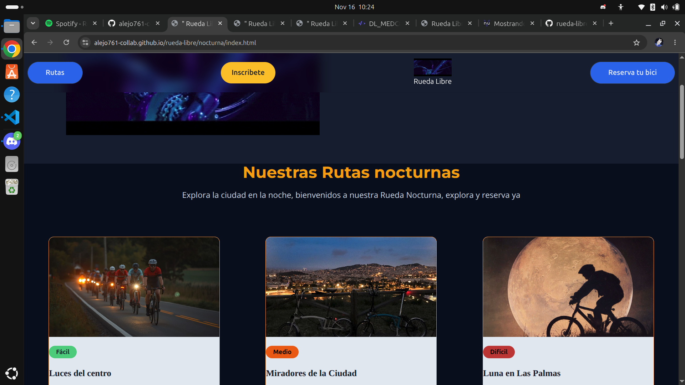
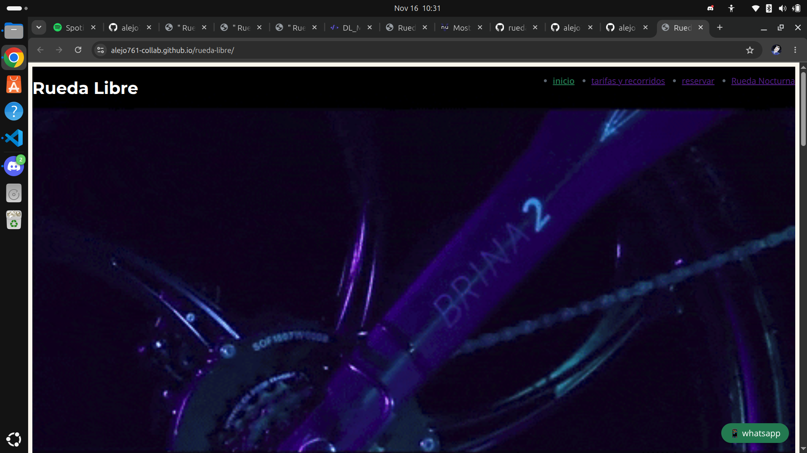
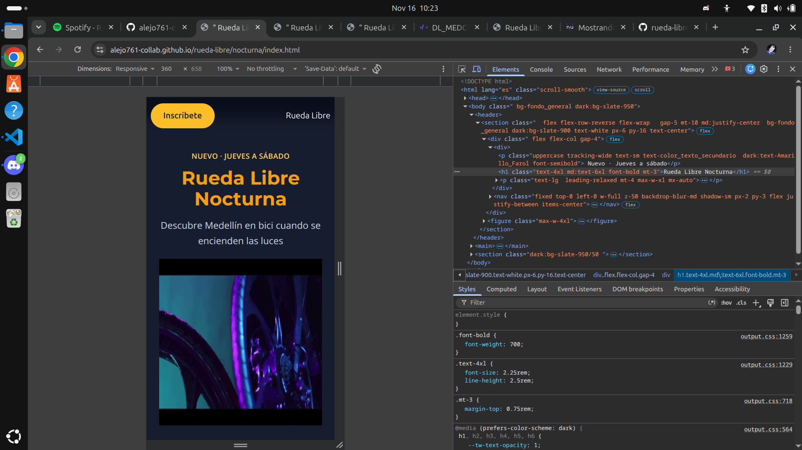
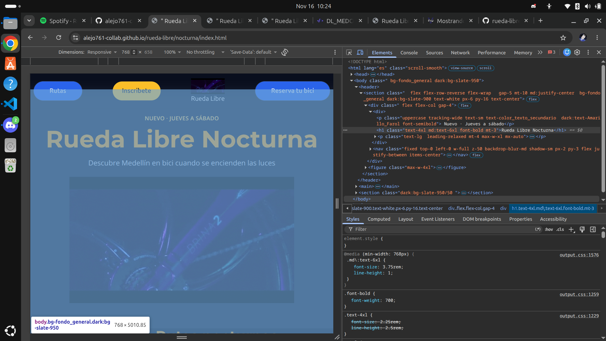

# 🚲 Rueda Libre y Rueda Nocturna

Hola, este es mi proyecto web para **Rueda Libre**, una empresa de alquiler de bicicletas y recorridos guiados en Medellín. El proyecto tiene dos partes: el sitio web principal del negocio y una landing page especial para los paseos en la noche (**Rueda Nocturna**).

---

## 🌐 Enlaces del proyecto

* **Página publicada (GitHub Pages):** [Ver sitio en vivo](https://alejo761-collab.github.io/rueda-libre/)
* **Repositorio en GitHub:** [https://github.com/alejo761-collab/rueda-libre]

---

## 📄 Páginas incluidas

* **Inicio (`index.html`):** Presentación de la empresa, tipos de bicicletas disponibles, servicios y ubicación.
* **Tarifas y Recorridos (`paginas/tarifas.html`):** Tablas con los precios por hora o día y las rutas disponibles por la ciudad.
* **Reservas (`paginas/reservas.html`):** Horarios de atención y formulario para reservar bicicletas.
* **Rueda Nocturna (`nocturna/index.html`):** Landing page con los planes nocturnos, precios y modo oscuro.

---

## 🛠️ Tecnologías y herramientas que usé

* **HTML5:** Para armar toda la estructura de las páginas y los formularios.
* **CSS3:** Para los estilos base del sitio principal.
* **Tailwind CSS (v3.4):** Para diseñar rápido la landing de Rueda Nocturna, las tarjetas y el diseño adaptable (responsive).
* **Bootstrap 5:** Lo usé en algunas pruebas y componentes para practicar cómo funciona.
* **Visual Studio Code:** Fue mi editor principal para escribir todo el código.
* **W3Schools, Gemini y Validador W3C:** Me apoyé mucho en W3Schools para consultar etiquetas y en el validador para corregir errores.
* **Git y GitHub Pages:** Para guardar los avances y subir la página a internet.

---

## 💡 ¿Qué framework recomiendo? (MiniReto 8)

Después de probar ambos, me quedo con **Tailwind CSS**. Al principio cuesta un poco acostumbrarse a poner muchas clases en el HTML, pero cuando le coges el ritmo te da mucha libertad para cambiar colores, tamaños y hacer el modo oscuro sin tener que pelear con los estilos que ya vienen fijos, como pasa a veces con Bootstrap. Bootstrap es muy bueno si quieres sacar algo súper rápido con componentes ya hechos, pero para personalizar un diseño propio prefiero Tailwind.

### Vista en Computador (Escritorio)

### Vista en Celular (Mobile)

### Landing Rueda Nocturna (Modo Oscuro)

---

## 📚 Lo que aprendí haciendo este proyecto

* A organizar mejor mis carpetas y tener cuidado con las mayúsculas y minúsculas en los nombres de los archivos para que no se rompan los enlaces al subirlos a GitHub Pages.
* Cómo hacer que una página se vea bien tanto en celular como en computador usando `grid` y `flex`.
* A validar los formularios desde el HTML usando `required`, `pattern`, `min` y `max`.
* La importancia de revisar el código en el validador del W3C para encontrar etiquetas mal cerradas o atributos repetidos.

---

 